<div align="center">

# MikroTik Ashgabat — Website Concept

**A multilingual product catalogue, inquiry platform and admin panel for a networking equipment business.**


[Overview](#overview) · [Features](#features) · [Tech stack](#tech-stack) · [Screenshots](#screenshots) · [Getting started](#getting-started) · [Documentation](#documentation)

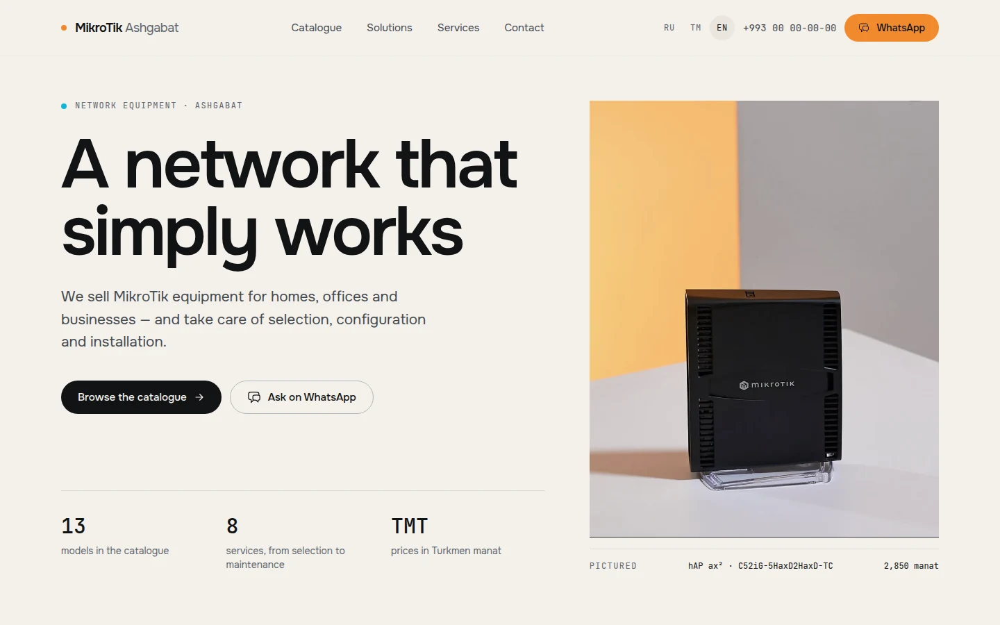

</div>

> [!IMPORTANT]
> **Independent concept — not an official website.** This project was designed and built independently to show how a network-equipment reseller in Ashgabat, Turkmenistan could present its catalogue online. It was not commissioned, approved or published by the business, and it has never been deployed. It is not affiliated with or endorsed by MikroTik. MikroTik and RouterOS are trademarks of SIA Mikrotīkls; Fortinet, FortiGate and Cisco are trademarks of their respective owners.

## Overview

The business sells and installs MikroTik routers, access points and firewalls, and reaches customers through Instagram and a PDF price list. This concept turns that material into a complete website: a searchable catalogue with prices in Turkmen manat, product pages with specifications, service and solution pages, and inquiry forms that land in an admin panel the owner can run without a developer.

It is a working Laravel application rather than a static mock-up: the catalogue is database-driven, every form is validated and stored, and the admin panel edits everything shown on the site.

| | |
|---|---|
| **Status** | Independent concept / demonstration. Not deployed. |
| **Languages** | Russian (default), Turkmen and English |
| **Scope** | Public website, admin panel, deployment kit, automated tests |

## Problem and proposed solution

| Problem | What the concept does about it |
|---|---|
| Products and prices live in Instagram posts and a PDF, so they are hard to search or compare. | A database-driven catalogue with search, category, audience and availability filters, sorting and pagination. |
| Customers ask for advice in direct messages, with no record of the request. | WhatsApp buttons with a prefilled message naming the model, plus inquiry forms stored in the admin panel with status and internal notes. |
| Changing a price means redesigning a PDF. | Inline price editing, photo upload and publishing controls in an admin panel. |
| Visitors read Russian, Turkmen or English, often on slow mobile connections. | Three languages with their own URLs, self-hosted fonts, responsive WebP images and under 3 KB of JavaScript on public pages. |

## Features

**Public website**

- Home, catalogue, product, services, solutions and contact pages in three languages. Russian URLs are unprefixed; Turkmen and English use `/tk` and `/en`. The language switcher keeps the current page and filters.
- Catalogue search across names, product codes, specifications and translations, with category, audience and availability filters, five sort orders and pagination. The filter form works without JavaScript.
- Product pages with a photo gallery, grouped specifications, price or "price on request", related products, and WhatsApp and inquiry calls to action.
- SEO: canonical URLs, `hreflang` alternates, Open Graph tags, JSON-LD (`Organization`, `Product`, `Offer`), `sitemap.xml` and `robots.txt`. The site is closed to search engines by default (`SITE_INDEXABLE=false`).
- Accessibility: skip link, landmarks, one `h1` per page, visible focus ring, labelled form fields with linked errors, and `prefers-reduced-motion` support.

**Inquiries**

- One endpoint handles product, service, consultation and contact forms.
- CSRF protection, server-side validation, a honeypot field, an encrypted timing token and two rate limits.
- Each inquiry stores a snapshot of the product and price at the time it was sent, the locale and page, and an HMAC of the IP address rather than the address itself.
- Optional e-mail notification; a mail failure never blocks the visitor.

**Admin panel (`/admin`, Filament 5)**

- Dashboard with catalogue and inquiry counters and the latest inquiries.
- Products: create, edit, inline price editing, photo upload with automatic WebP variants, specifications, availability, featured and published flags, duplicate, soft delete and restore.
- Categories with guarded deletion (products must be moved first), services, and inquiries with status, internal notes and WhatsApp or call shortcuts.
- Website settings for contact details, delivery text and price display, and a per-user panel language (Russian or English).

**Engineering**

- Security headers and a strict Content-Security-Policy on public pages (`script-src 'self'`, no third-party origins).
- Contact details are configuration, not code: the repository ships fictional placeholders.
- 119 automated tests (578 assertions) and browser-driven audit scripts.
- A self-verifying release builder for DirectAdmin shared hosting, plus an nginx example for a VPS.

## Tech stack

| Layer | Technology |
|---|---|
| **Language** | PHP 8.3+ |
| **Backend** | Laravel 13 (routing, Eloquent, validation, mail, rate limiting) |
| **Admin** | Filament 5 on Livewire 4 (admin panel only) |
| **Frontend** | Blade templates and components, Tailwind CSS 4, vanilla JavaScript (progressive enhancement), Heroicons |
| **Build** | Vite 8 with `laravel-vite-plugin`; fonts (Onest, JetBrains Mono) are downloaded at build time and self-hosted |
| **Database** | MariaDB 11.4 (MySQL 8 compatible) |
| **Images** | PHP GD for WebP variants; a Python 3 + Pillow script for editorial image sets and the social card |
| **Testing and QA** | PHPUnit 12, Laravel Pint, Playwright audit scripts |
| **Infrastructure** | Docker (local database), Apache/LiteSpeed `.htaccess` kit for DirectAdmin, nginx server block for a VPS |

Node.js is needed only to build assets; there is no Node process in production.

## Architecture

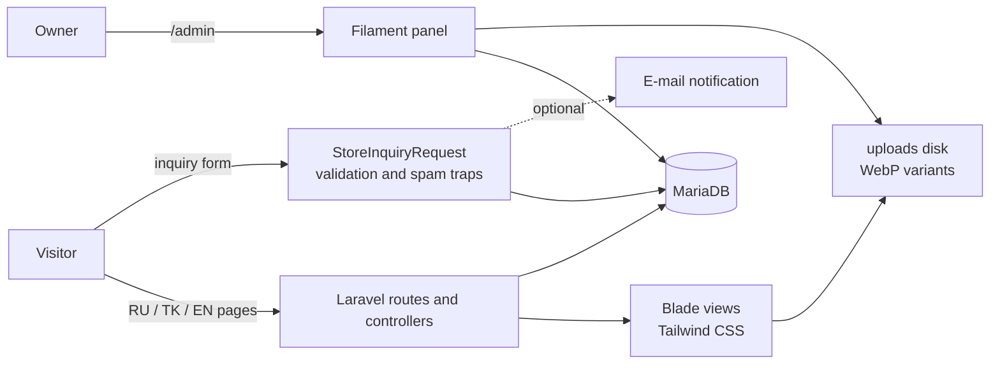

- **Localisation.** One set of routes is registered twice: unprefixed for Russian and prefixed for Turkmen and English. Translatable content is stored as JSON per attribute and read through a `HasTranslations` trait that falls back to Russian.
- **Catalogue.** A `CatalogFilters` value object validates the query string against enums and whitelists, then applies search, filters and sorting to the query.
- **Settings.** Contact details and site texts are stored as key/value settings, cached, and editable in the admin panel. Defaults come from environment variables.
- **Images.** Uploads go to a public disk with host-relative URLs, and each image gets 480, 960 and 1600 px WebP variants generated with GD.

See [docs/TECHNICAL_ARCHITECTURE.md](docs/TECHNICAL_ARCHITECTURE.md) for the request flow, security measures and performance figures.

## Project structure

```
app/
├── Console/Commands/      app:create-admin
├── Enums/                 Availability, InquiryStatus, InquiryType, PreferredContact, Segment
├── Filament/              admin resources, pages, widgets and form helpers
├── Http/                  controllers, middleware (locale, security headers), form request
├── Models/                Product, Category, Service, Inquiry, Setting, User …
└── Support/               Settings, CatalogFilters, Money, Media/ImageVariants
config/site.php            locales, currency, contact defaults, indexing switch, rate limits
database/
├── data/catalog.php       demo catalogue data
├── migrations/  seeders/  factories/
deployment/                DirectAdmin kit, nginx example, release builder
docs/                      architecture, design system, data model, guides, screenshots
lang/{ru,tk,en}/           interface strings
resources/                 Blade views, CSS design tokens, JavaScript
tests/                     Unit, Feature and Feature/Admin suites
tools/                     media build script and browser-driven QA scripts
```

## Screenshots

All screenshots were captured from the running application with demo data.

| Catalogue | Product page |
|---|---|
| 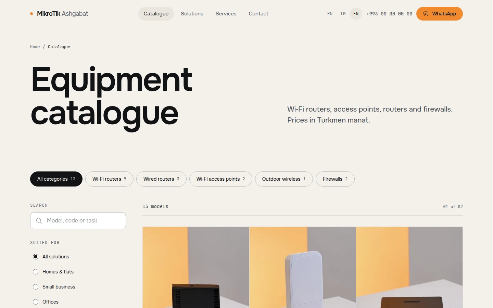 | 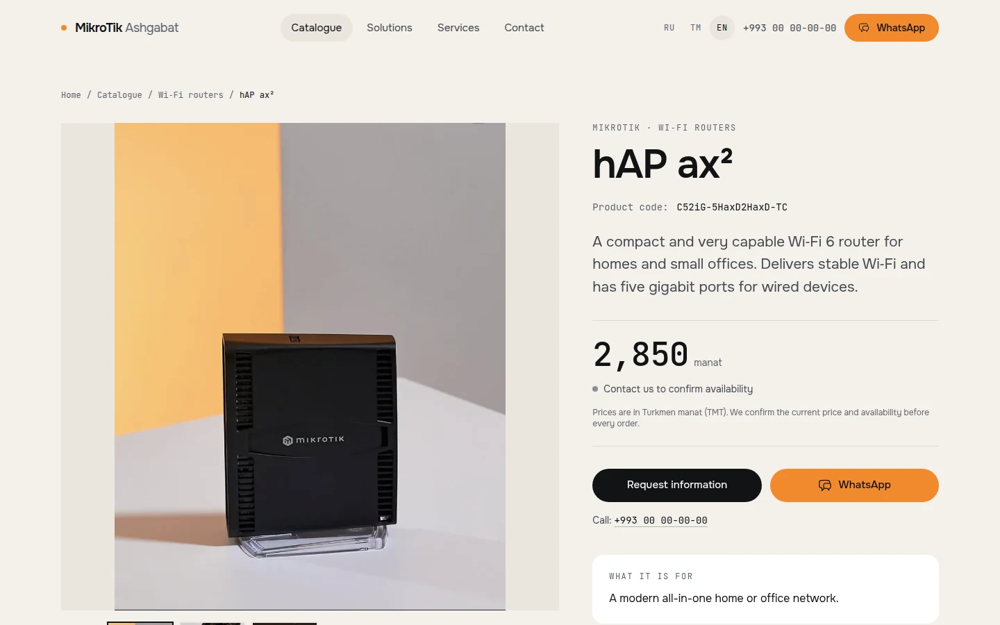 |

| Solutions | Services |
|---|---|
| 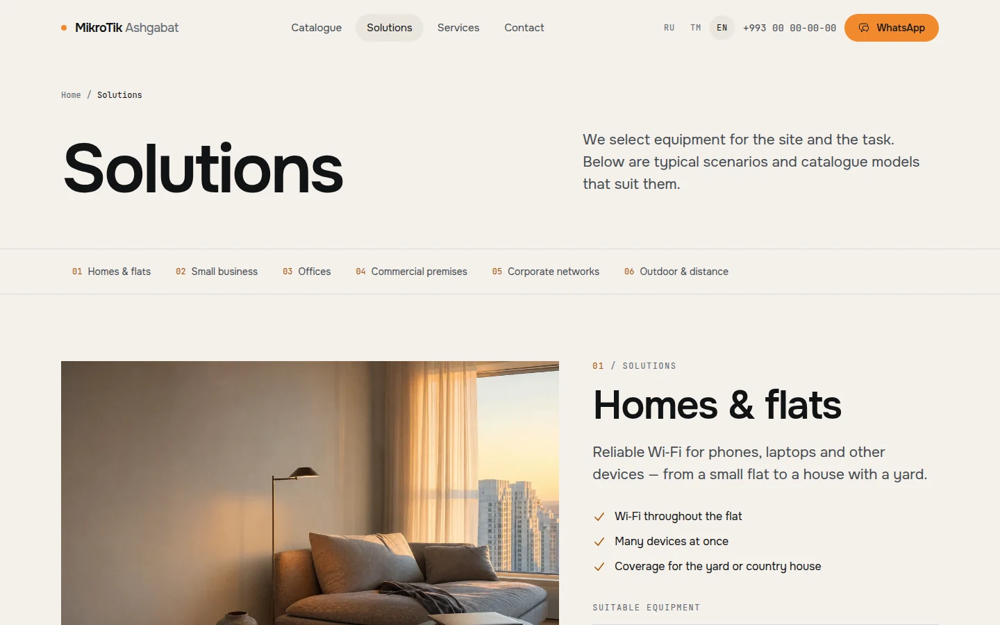 | 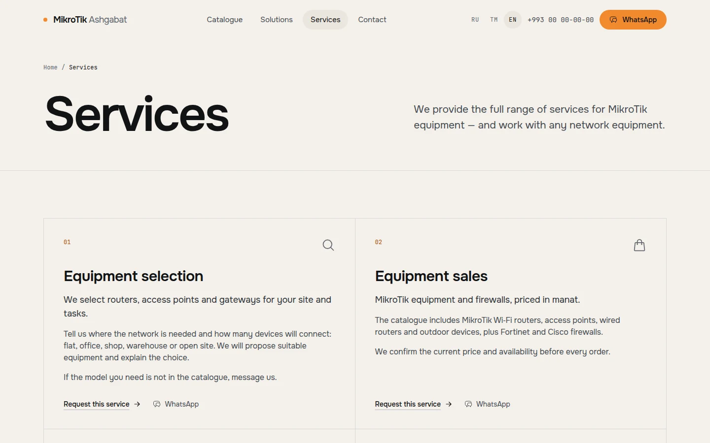 |

**Mobile**

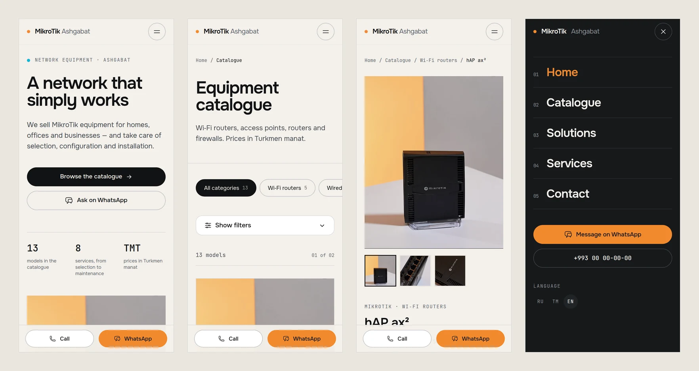

**Admin panel**

| Dashboard | Products |
|---|---|
| 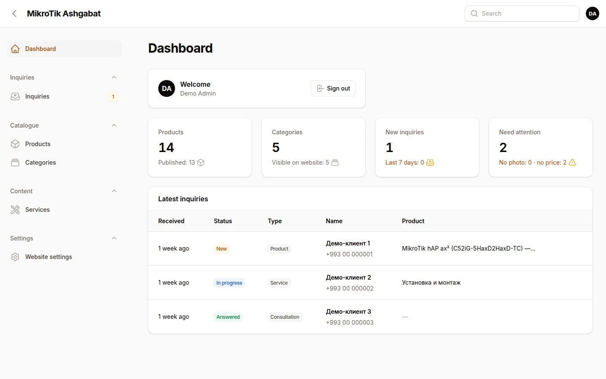 | 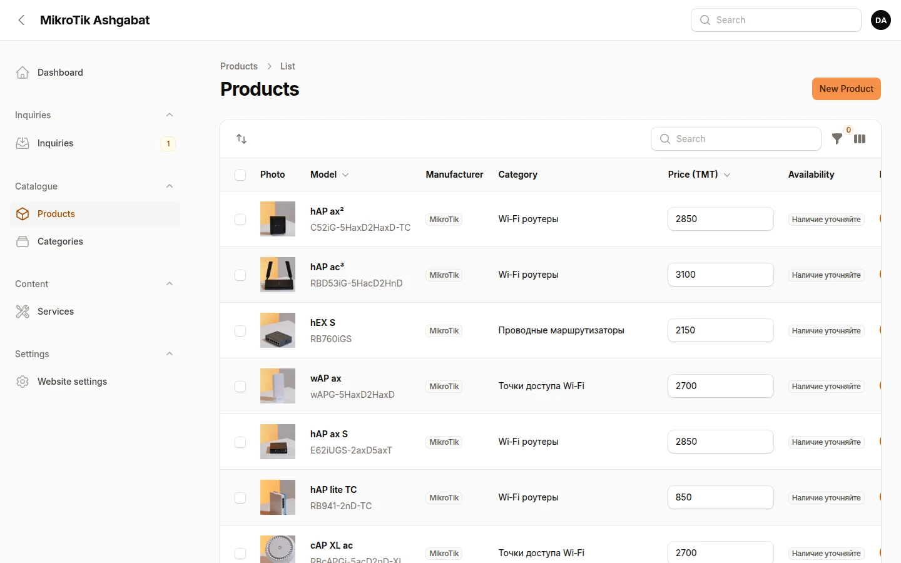 |

| Product editor | Inquiries |
|---|---|
| 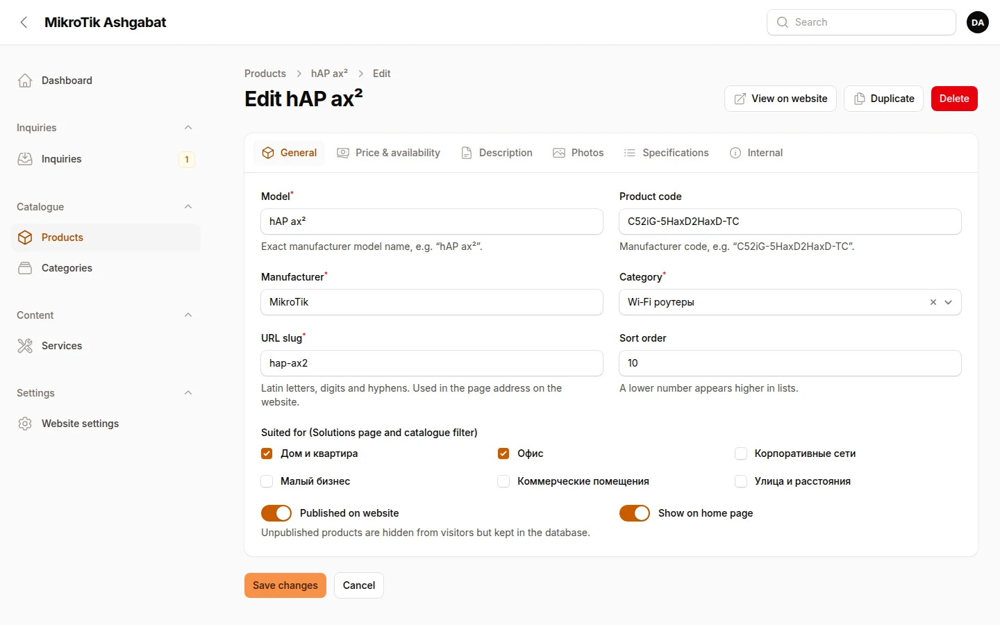 | 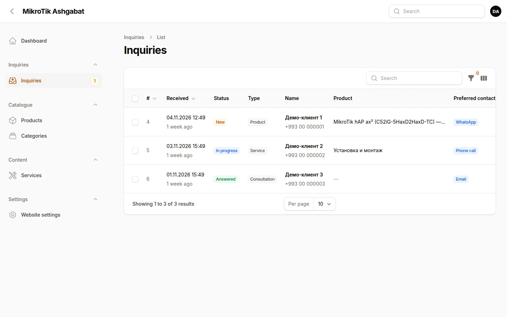 |

More: [full home page](docs/screenshots/home-full.webp) · [home page in Russian](docs/screenshots/home-ru.webp) · [contact page](docs/screenshots/contact.webp) · [website settings](docs/screenshots/admin-settings.webp)

> Product photographs visible in the screenshots belong to the business and are shown for illustration only. They are **not distributed with this repository**: a fresh installation shows a neutral placeholder for each product until photos are uploaded in the admin panel.

## Getting started

### Requirements

- PHP 8.3+ with `pdo_mysql`, `mbstring`, `intl`, `gd` (with WebP), `zip`, `exif` and `fileinfo`
- Composer 2
- Node.js 20.19+
- MariaDB 10.11+ or MySQL 8 (the example below uses Docker)

### Installation

```bash
git clone https://github.com/dovlet808/mikrotik-ashgabat-website-concept.git
cd mikrotik-ashgabat-website-concept

# 1. Database (MariaDB in Docker on port 3310)
docker run -d --name mikrotik-db -p 127.0.0.1:3310:3306 \
  -e MARIADB_DATABASE=mikrotik -e MARIADB_USER=mikrotik \
  -e MARIADB_PASSWORD='choose-a-password' -e MARIADB_ROOT_PASSWORD='choose-another' \
  -v mikrotik-db-data:/var/lib/mysql \
  mariadb:11.4 --character-set-server=utf8mb4 --collation-server=utf8mb4_unicode_ci

# 2. Application
cp .env.example .env              # then set DB_PASSWORD
composer install
php artisan key:generate
npm install && npm run build
php artisan migrate --seed        # imports the demo catalogue
php artisan app:create-admin      # prompts for e-mail and password (or add --generate)
```

### Local development

```bash
php artisan serve --host=127.0.0.1 --port=8097
npm run dev                       # optional: Vite with hot reload
```

- Website: <http://127.0.0.1:8097> (Turkmen at `/tk`, English at `/en`)
- Admin panel: <http://127.0.0.1:8097/admin>
- Optional sample inquiries for the admin panel: `php artisan db:seed --class=DemoInquirySeeder`

### Environment variables

`.env.example` documents every variable. The ones specific to this project:

| Variable | Default | Purpose |
|---|---|---|
| `SITE_PHONE` | `+99300000000` (placeholder) | Phone number shown until the admin Settings page overrides it |
| `SITE_WHATSAPP` | `99300000000` (placeholder) | Number used by every WhatsApp link |
| `SITE_INSTAGRAM_HANDLE` | empty | Instagram account; the link is hidden when empty |
| `SITE_INDEXABLE` | `false` | `true` allows search engines; keep `false` for a concept |
| `SITE_CONCEPT_MODE` | `true` | Shows the "independent concept" notice in the footer |
| `SITE_CURRENCY` | `TMT` | ISO 4217 currency code for prices |
| `INQUIRY_RATE_LIMIT` | `5` | Stored inquiries allowed per IP address per 10 minutes |
| `INQUIRY_NOTIFY_EMAIL` | empty | Fallback recipient for new-inquiry e-mails |
| `SITE_SEED_IMAGES` | `true` | Copy product photos from `media/products/` when seeding, if that folder exists |

### Tests and code style

```bash
# once: a test database the application user can access
docker exec -it mikrotik-db mariadb -uroot -p \
  -e "CREATE DATABASE mikrotik_test CHARACTER SET utf8mb4; GRANT ALL ON mikrotik_test.* TO 'mikrotik'@'%';"

php artisan test                  # 119 tests
vendor/bin/pint --test            # code style
```

The scripts in `tools/qa/` run browser-driven audits with Playwright (every public page in three languages, an admin panel audit and an admin workflow test on a disposable database copy). Each script documents its usage in its header.

### Production build

```bash
npm run build                     # compiled CSS, JS and fonts in public/build
./deployment/build-release.sh     # upload-ready release for DirectAdmin in dist/
```

The release builder copies an explicit list of runtime paths, installs production dependencies, and then verifies the archive: it fails if a private file is included, a required file is missing, or a local secret appears in the output.

## Deployment

**This project is not deployed.** The repository includes a deployment kit that was rehearsed locally only:

- [docs/DEPLOYMENT_DIRECTADMIN.md](docs/DEPLOYMENT_DIRECTADMIN.md): shared hosting with the application outside the web root.
- [docs/VPS_REQUIREMENTS.md](docs/VPS_REQUIREMENTS.md): server sizing and an nginx configuration.

## Documentation

| Document | Contents |
|---|---|
| [TECHNICAL_ARCHITECTURE.md](docs/TECHNICAL_ARCHITECTURE.md) | Stack, directory layout, localisation, security, performance, testing |
| [DESIGN_SYSTEM.md](docs/DESIGN_SYSTEM.md) | Visual direction, colour tokens, typography, components, accessibility checklist |
| [CONTENT_AND_DATA_MODEL.md](docs/CONTENT_AND_DATA_MODEL.md) | Entities, translations and how the demo content maps to the site |
| [ADMIN_GUIDE.md](docs/ADMIN_GUIDE.md) | Guide to the admin panel (Russian, with an English summary) |
| [DEPLOYMENT_DIRECTADMIN.md](docs/DEPLOYMENT_DIRECTADMIN.md) | Shared-hosting deployment, step by step |
| [VPS_REQUIREMENTS.md](docs/VPS_REQUIREMENTS.md) | VPS specification and setup |

## Known limitations

- **Demo content.** Product names, specifications, descriptions and prices were compiled from the business's public price list and Instagram posts in 2026. They may be out of date, and they remain the property of their respective owners.
- **No product photographs in the repository.** See the note under [Screenshots](#screenshots).
- **Translations.** Turkmen and English texts were translated for this concept and have not been reviewed by a native speaker.
- **Stock status** is a neutral "please confirm availability" for every product, because no live stock data exists.
- **No online payment** by design: the site collects inquiries only.
- **Not deployed**, so production behaviour is verified only in a local rehearsal.

## Future improvements

- Native-speaker review of the Turkmen and English content.
- Stock and price import from a spreadsheet, so the catalogue can be updated in bulk.
- Product comparison for models in the same category.
- A continuous integration workflow that runs the test suite and code style check on every push.
- A queue for notification e-mails once the site has real traffic.

## Author

Designed and developed by **Dovlet Halykov** — [github.com/dovlet808](https://github.com/dovlet808)
